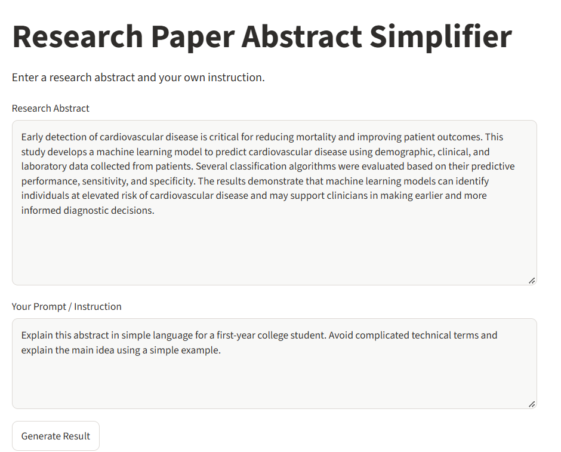
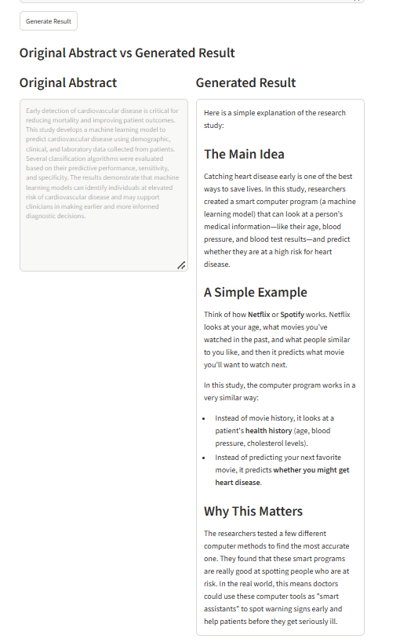
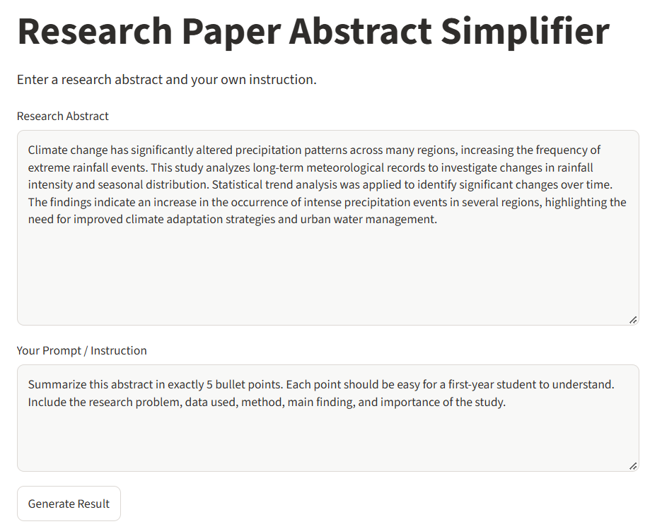
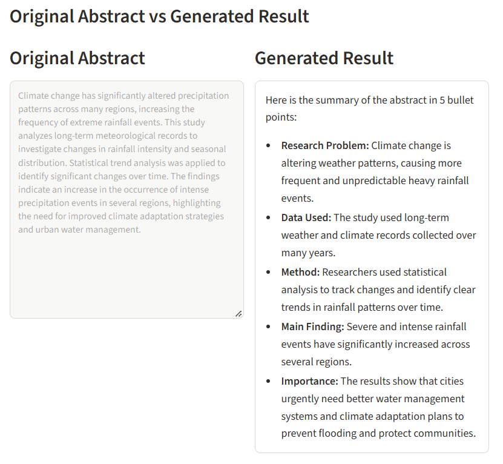

# Research Paper Abstract Simplifier

An AI-powered web application that helps students understand complex research paper abstracts using simple language and customized instructions.

The user pastes a research abstract and writes their own prompt. Both are sent to Google's Gemini model, which generates a response according to the instruction. The original abstract and the generated result are shown side by side.


---

## 🎯 Problem Statement

Research abstracts are full of jargon. Rewrite an abstract in simple language for a first-year student.

### About the Problem

Research papers are written for experts, so their abstracts use technical terms, long sentences and field-specific vocabulary. A first-year student who is new to a subject often cannot tell what the study did, what it found, or why it matters. Since the abstract is usually the first thing a reader sees, this becomes a barrier to learning.

**Who it helps:** first-year students, beginners in a new field, and anyone who wants to quickly understand a research paper.

---

## 💡 Proposed Solution

Paste abstract → write a prompt (for example, "explain for a first-year student, list difficult terms with meanings") → show the original and the simplified version side by side.

The application takes two inputs:

1. **Research Abstract**
2. **User Prompt / Instruction**

It sends both to the Gemini API and displays the generated response next to the original abstract, so the reader can compare them easily.

---

## ✨ Features

- 📝 Enter any research paper abstract
- 💬 Enter your own prompt or instruction
- 🤖 Generate AI responses using Google Gemini
- 📖 Simplify complex research language
- 📋 Summarize abstracts, for example in a fixed number of bullet points
- 🔍 Ask for difficult technical terms with their meanings (through the prompt)
- ↔️ Show the original abstract and generated result side by side
- ⏳ Loading spinner while the response is generated
- ⚠️ Warnings for empty inputs and error messages if the API call fails
- 🔐 API key kept outside the source code in a `.env` file

---

## 🔄 Application Workflow

```text
1. User opens the application
              ↓
2. User enters a research abstract
              ↓
3. User enters a prompt
              ↓
4. Application checks that both inputs are filled
              ↓
5. Abstract + prompt are sent to Gemini
              ↓
6. Gemini returns the generated response
              ↓
7. Original abstract and generated result
   are displayed side by side
```

---

## 🛠️ Technology Stack

| Part | Tool |
|------|------|
| Language | Python |
| UI | Streamlit |
| LLM | Google Gemini (`gemini-3.5-flash`) |
| SDK | `google-genai` |
| Config | `python-dotenv` (API key in a `.env` file) |

---

## 📂 Project Structure

```text
ResearchAbstractSimplifier/
│
├── app.py              # Streamlit application
├── requirements.txt    # Python dependencies
├── README.md           # Project documentation
├── .gitignore          # Keeps .env and venv out of GitHub
├── screenshots/        # Images used in this README
└── .env                # Gemini API key (local only, not uploaded)
```

> **Important:** The `.env` file contains your API key and must never be uploaded to GitHub.

---

## 🚀 Installation and Setup

### 1. Clone the repository

```bash
git clone <YOUR_GITHUB_REPOSITORY_URL>
cd <YOUR_REPOSITORY_FOLDER>
```

### 2. Create and activate a virtual environment (recommended)

```bash
python -m venv venv
```

Windows PowerShell:

```powershell
.\venv\Scripts\Activate.ps1
```

macOS / Linux:

```bash
source venv/bin/activate
```

### 3. Install the dependencies

```bash
pip install -r requirements.txt
```

### 4. Add your Gemini API key

Create a file named `.env` in the project folder and add:

```text
GEMINI_API_KEY=YOUR_API_KEY_HERE
```

You can get a key from [Google AI Studio](https://aistudio.google.com/).

### 5. Run the application

```bash
streamlit run app.py
```

Open the local URL shown in the terminal (usually http://localhost:8501).

---

## 🖥️ How to Use

1. Paste a research paper abstract into the **Research Abstract** box.
2. Type an instruction in the **Your Prompt / Instruction** box.
3. Click **Generate Result**.
4. Read the **Original Abstract** and the **Generated Result** side by side.

---

## 🧪 Examples

### Example 1: Simple explanation with an example

**Prompt:**

```text
Explain this abstract in simple language for a first-year college student. Avoid complicated technical terms and explain the main idea using a simple example.
```

**Input:**



**Output:** the model explains the main idea and compares the prediction model to how Netflix or Spotify recommends content.



### Example 2: Summary in exactly 5 bullet points

**Prompt:**

```text
Summarize this abstract in exactly 5 bullet points. Each point should be easy for a first-year student to understand. Include the research problem, data used, method, main finding, and importance of the study.
```

**Input:**



**Output:** the model returns exactly 5 bullet points covering the research problem, data used, method, main finding and importance.



### More prompt ideas

- `Explain this abstract in simple language, then list at least 6 difficult technical terms with simple meanings.`
- `Identify the research problem, method, main findings and conclusion, and explain each in simple language.`

---

## 🔐 Security

The Gemini API key is stored in an environment variable (`.env`) instead of being written in the Python code. The `.gitignore` file keeps it out of GitHub:

```text
venv/
.env
__pycache__/
*.pyc
```

---

## ✅ Input Validation

The application checks that:

- A research abstract has been entered
- A prompt has been entered

If either is missing, a warning is shown. If the API call fails, an error message is displayed.

---

## ⚠️ Limitations

- The result depends on the quality of the user's prompt.
- AI-generated explanations may leave out small details or contain mistakes, so read them together with the original abstract.
- An internet connection and a valid Gemini API key are required.
- The app works with pasted abstracts, not complete PDF papers.

---

## 🔮 Future Improvements

- Automatic glossary of difficult terms with meanings
- PDF paper upload with automatic abstract extraction
- Download the generated explanation
- History of previous queries
- Multiple language support

---

## 🎓 What This Project Demonstrates

- Python and Streamlit app development
- Integrating a Large Language Model (LLM) API
- Prompt engineering
- Environment variables for secret keys
- Basic input validation and error handling
- GitHub project organization

---

## 👩‍🎓 Academic Project

**Project:** Research Paper Abstract Simplifier  
**Technology:** Python + Streamlit + Google Gemini API  
**Type:** LLM / Generative AI Mini Project
